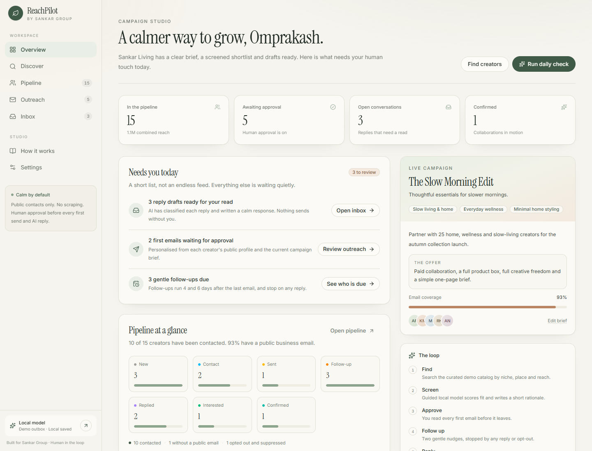
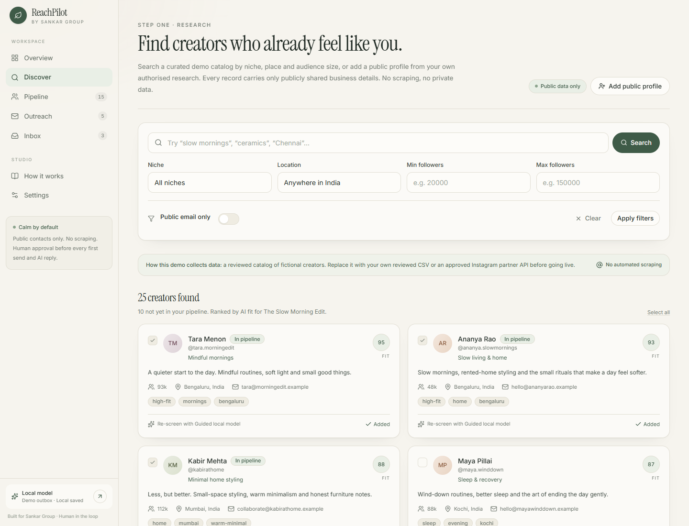
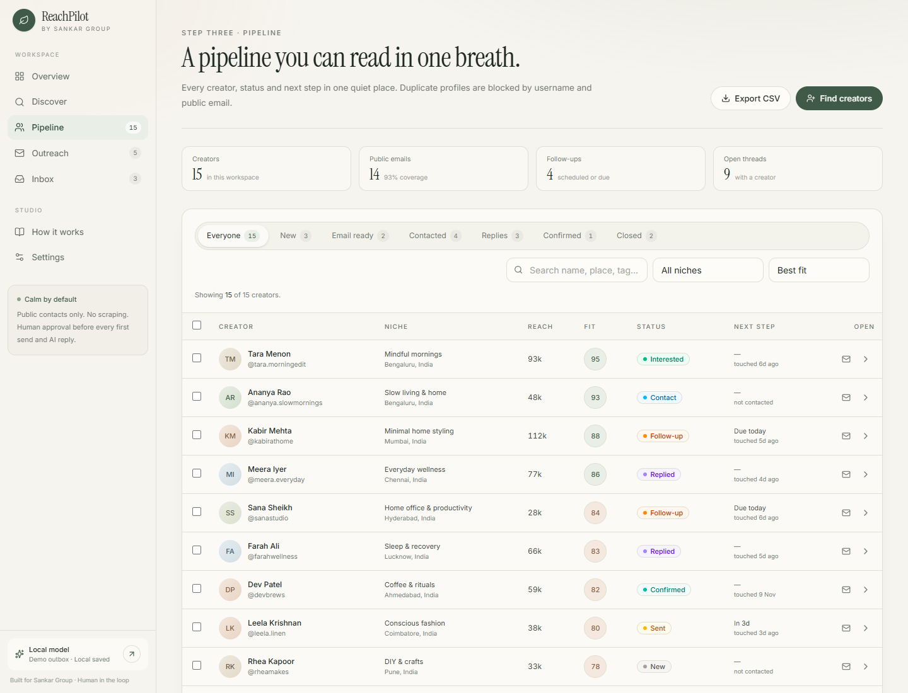
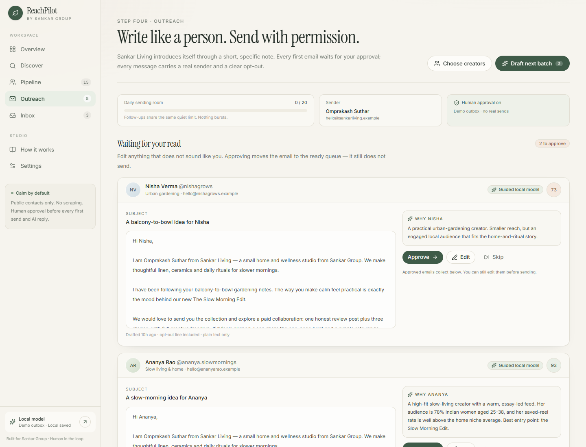
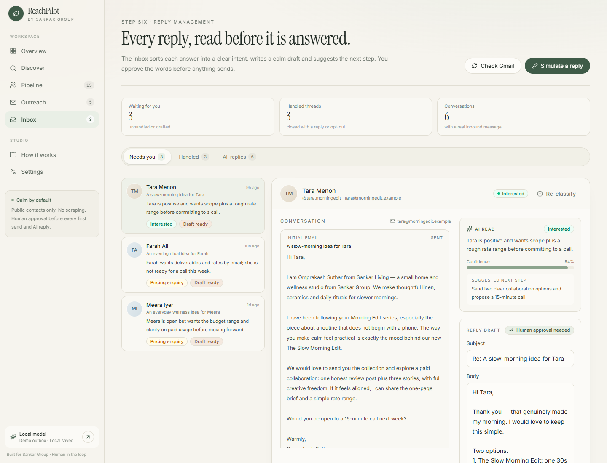

# ReachPilot

**A calmer way to find and partner with creators.**

ReachPilot is an AI-assisted influencer research, outreach and reply studio built
for the **Sankar Group AI Automation Internship** assignment. It runs the complete
loop:

> research → collect public contacts → AI screening → CRM → personalised email →
> human approval → follow-ups → reply classification → AI reply draft → CRM update

The interface is intentionally quiet: warm paper, sage accents, one clear next
action per screen. The automation underneath is real, and every
relationship-changing email still waits for a human.

[](https://nextjs.org)
[](https://react.dev)
[](https://www.typescriptlang.org)
[](https://vercel.com)
[](https://www.anthropic.com)

**Live demo:** <https://reachpilot-ai.vercel.app>  
**Assignment guide (PDF):** <https://reachpilot-ai.vercel.app/docs/reachpilot-assignment-guide.pdf>  
**Walkthrough:** open `/guide` inside the app.



## Why this exists

A small team can spend a whole day on influencer outreach and still lose the
thread: research lives in one tab, contacts in a sheet, drafts in Gmail, replies in
an inbox, and follow-ups in someone's memory. ReachPilot turns that into one
visible pipeline. It is designed to feel like a studio, not a growth-hacking
dashboard.

The demo uses **fictional creators and `.example` email addresses**. Nothing is
scraped from Instagram, no account is logged in, and no real person is contacted.
The workflow is built for public business contacts and authorised research.

## What the demo shows

| Assignment area | How ReachPilot handles it |
| --- | --- |
| **1. Instagram research** | Discover filters a curated 25-creator catalog by keyword, niche, location, follower range and public-email availability, or lets you add a public profile found through authorised research. Public-style contact details only. No scraping or private data. |
| **2. Claude AI filtering** | Fit score, tier, short profile summary and tags for every creator, generated from the brand brief and public bio. Claude via Anthropic API or Vercel AI Gateway; high-quality guided local model when no key is present. |
| **3. Google Sheets / CRM** | Built-in CRM with the exact requested statuses, duplicate blocking by username/email, private notes, full conversation history and one-click CSV export for Google Sheets. |
| **4. AI cold email** | Personalised initial drafts built from the creator's niche, bio and a specific reason for selection. Human approval is required before the first send. Daily cap, sender identification and opt-out line included. |
| **5. Follow-ups** | Day 4 and day 6 follow-ups, configurable in Settings. The engine skips anyone who replied, declined or opted out. Automatic mode or approval-first mode. |
| **6. AI reply management** | Gmail sync or in-app reply simulation. Classifies interested / pricing / collaboration / not interested / opt-out / question / other, writes a summary, suggests the next action, drafts a reply and updates CRM status. Human approval before sending. |
| **7. End-to-end demo** | One shared workspace, seeded with 15 creators, live replies, due follow-ups, approved drafts and a confirmed collaboration. Reset from Settings at any time. |

### Screens

| Discover | Pipeline |
| --- | --- |
|  |  |

| Outreach | Inbox |
| --- | --- |
|  |  |

## Try it in 60 seconds

1. Open the **Overview**. The “Needs you today” card shows reply drafts, first
   emails waiting for approval, and follow-ups that are due.
2. Go to **Discover**, search `Sleep & recovery` in `Kochi`, and add **Maya
   Pillai** to the pipeline.
3. Open **Outreach**. Edit Maya's draft if you like, approve it, then send it to
   the private demo outbox.
4. Open **Inbox → Simulate a reply**. Paste a pricing question. The AI
   classifies it, updates Maya's status and creates a reply draft.
5. Approve the reply, then open **Pipeline** to see the updated status.
6. Finish at **Settings → Reset demo workspace** to restore the seeded data.

For a longer, click-by-click narrative, see
[`docs/DEMO_SCRIPT.md`](docs/DEMO_SCRIPT.md).

## How it works

```text
Instagram / authorised source (public business information only)
                    │
                    ▼
        Discover + filters + duplicate check
                    │
                    ▼
   Claude / AI Gateway / guided local model
     score · tier · tags · profile summary
                    │
                    ▼
     CRM pipeline  ──────────────►  CSV export
                    │
                    ▼
   AI email draft → human approval → Gmail / demo outbox
                    │
                    ▼
   Follow-up engine (day 4 / day 6, stop rules)
                    │
                    ▼
   Inbox → AI classification → reply draft → human approval
                    │
                    ▼
            CRM status update
```

Everything is one Next.js application: server components for the shell, server
actions for mutations, and a small JSON workspace behind a storage adapter.

### The daily loop

`/api/cron/tick` runs two passes:

1. Check Gmail for unread replies, classify new ones and create reply drafts.
2. Find threads whose follow-up is due, respect the daily limit, send the
   appropriate follow-up, and schedule the next one — unless a reply, decline or
   opt-out has arrived.

The same loop is available as a button in the sidebar, and as an importable n8n
workflow at [`public/n8n/reachpilot-daily.json`](public/n8n/reachpilot-daily.json).

## Tech stack

| Layer | Choice |
| --- | --- |
| App | Next.js 16 App Router, React 19, TypeScript |
| Styling | Tailwind CSS 4, self-hosted Instrument Serif + Inter |
| AI | Anthropic Claude (`claude-sonnet-4-5` default) or Vercel AI Gateway; deterministic guided fallback |
| Email | Gmail API with OAuth refresh token; private demo outbox by default |
| CRM | JSON workspace with the eight requested statuses plus Opted out |
| Storage | Private Vercel Blob in production; `.data/workspace.json` in development; in-memory fallback |
| Automation | Vercel Cron / protected HTTP endpoint; n8n workflow companion |
| Hosting | Vercel |

## Run locally

```bash
git clone https://github.com/OPBSUTHAR/reachpilot-ai.git
cd reachpilot-ai
npm install
cp .env.example .env.local
npm run dev
```

Open <http://localhost:3000>. No keys are required. The app starts on the guided
local model and the demo outbox, with a seeded workspace.

```bash
npm run lint          # ESLint
npx tsc --noEmit      # type check
npm run build         # production build
npm run start         # serve the production build
```

## Environment variables

All integrations are optional. The app is designed to run end-to-end without a
single secret.

| Variable | Required | Purpose |
| --- | --- | --- |
| `ANTHROPIC_API_KEY` | No | Use Claude for screening, email and reply analysis |
| `ANTHROPIC_MODEL` | No | Override the default `claude-sonnet-4-5` |
| `AI_GATEWAY_API_KEY` | No | Use Vercel AI Gateway when Anthropic is not set |
| `AI_GATEWAY_MODEL` | No | Override the default `anthropic/claude-sonnet-4.5` |
| `GMAIL_CLIENT_ID` | No | Gmail OAuth client |
| `GMAIL_CLIENT_SECRET` | No | Gmail OAuth client secret |
| `GMAIL_REFRESH_TOKEN` | No | Long-lived Gmail token |
| `GMAIL_SENDER_EMAIL` | No | Authorised Gmail sender address |
| `GMAIL_SENDER_NAME` | No | Optional From display name |
| `BLOB_READ_WRITE_TOKEN` | No | Private Vercel Blob store (auto-injected when connected) |
| `BLOB_STORE_ID` | No | Alternative to the read/write token when using OIDC |
| `CRON_SECRET` | No | Protects `/api/cron/tick`; use in production |

See [`.env.example`](.env.example) for the annotated version.

### Connect Claude

1. Create a key at <https://console.anthropic.com/>.
2. Add `ANTHROPIC_API_KEY` to `.env.local` or the Vercel project.
3. Restart. The sidebar changes from **Guided local model** to **Claude**.

Or add `AI_GATEWAY_API_KEY` and let the app route through Vercel AI Gateway. If a
provider call fails or returns non-JSON, ReachPilot silently falls back to the
deterministic local model so the demo never dead-ends.

### Connect Gmail

1. Create a Google Cloud project and enable the **Gmail API**.
2. Configure the OAuth consent screen. Add your own account as a test user while
   the app is unverified.
3. Create an **OAuth 2.0 Web application** and add
   `http://localhost:53682/oauth2callback` as an authorised redirect URI.
4. Put `GMAIL_CLIENT_ID` and `GMAIL_CLIENT_SECRET` in `.env.local`.
5. Run:

   ```bash
   npm run gmail:auth
   ```

6. Copy the printed `GMAIL_REFRESH_TOKEN` and `GMAIL_SENDER_EMAIL` into
   `.env.local`, then restart.

The adapter requests `https://www.googleapis.com/auth/gmail.modify`, sends
plain-text mail with a `List-Unsubscribe` header, and only reads unread replies
from the last 14 days. Addresses ending in `.example`, `.test` or `.invalid` are
**always** delivered to the demo outbox, even when Gmail is configured, so test
data can never leak into a real inbox.

### Storage

In development the workspace is saved to `.data/workspace.json`. On Vercel,
connect a **private Blob store** to the project; the app picks up
`BLOB_READ_WRITE_TOKEN` and stores `reachpilot/workspace.json`. If no storage is
available, the app falls back to an in-memory workspace so the UI still works.

### Automation

`vercel.json` registers a daily cron at 03:00 UTC. Set `CRON_SECRET` in Vercel;
Vercel Cron sends it as a bearer token. The endpoint also accepts
`?secret=...` for manual testing. Without `CRON_SECRET`, the endpoint is open —
do not run production that way.

The n8n companion workflow expects two environment variables in n8n:
`REACHPILOT_URL` (for example `https://your-app.vercel.app`) and
`REACHPILOT_CRON_SECRET`.

## API

| Endpoint | Method | What it does |
| --- | --- | --- |
| `/api/workspace` | `GET` | Workspace state plus engine, email, storage and demo metadata |
| `/api/actions` | `POST` | The single action dispatcher (`{ type, payload }`) |
| `/api/export?type=leads` | `GET` | CSV of the CRM |
| `/api/export?type=outreach` | `GET` | CSV of every outbound message |
| `/api/export?type=replies` | `GET` | CSV of reply threads and classifications |
| `/api/gmail/sync` | `POST` | Pull unread replies and draft responses |
| `/api/cron/tick` | `GET`/`POST` | Reply sync + follow-up pass |
| `/api/health` | `GET` | Status, engine, Gmail readiness and counts |

Action types include `discover.run`, `leads.add`, `leads.update`,
`outreach.draft`, `outreach.approve`, `outreach.send`, `replies.simulate`,
`replies.classify`, `replies.draft`, `replies.approveSend`, `followups.send`,
`settings.update` and `data.reset`.

## Status model

```text
New lead → Email available → Email sent → Follow-up due → Replied
         → Interested → Collaboration confirmed
         ↘ Not interested
         ↘ Opted out (suppressed from all future contact)
```

Duplicate records are blocked by Instagram username and public email before a
creator enters the CRM. Opted-out creators stay visible for audit but are removed
from every send and follow-up queue.

## Compliance and safety

- **Public business contacts only.** No private data, no login, no scraping, no
  Instagram DM automation. The demo catalog is explicitly fictional.
- **Human approval by default.** The first campaign send and every AI-written
  reply require an explicit approval. The setting is visible and locked in the UI.
- **Reasonable limits.** A configurable daily send cap prevents runaway mail.
- **Clear identity and opt-out.** Every email names the sender and brand and
  includes an unsubscribe line; opt-outs stop all future contact.
- **No silent AI.** Scores, summaries and suggested actions are visible for review.
  Provider failures fall back to a deterministic local model.
- **Demo isolation.** `.example` addresses can never be delivered through Gmail.

## Project structure

```text
src/
  app/                 Overview, Discover, Pipeline, Outreach, Inbox, Settings, Guide
  components/          App shell, UI primitives, lead detail, workspace provider
  lib/
    actions.ts         The action dispatcher and all workflow mutations
    ai.ts              Claude / AI Gateway adapters + guided local fallback
    candidates.ts      Curated 25-creator demo catalog and filters
    email.ts           Gmail OAuth sender and unread-reply reader
    seed.ts            15 seeded leads, threads, drafts and activity
    store.ts           Blob / file / memory workspace adapter
    types.ts           Domain model
  app/api/             Workspace, actions, exports, Gmail sync, cron, health
docs/
  DEMO_SCRIPT.md       6-minute recording script
  sample-emails.md     Real initial, follow-up, inbound and reply draft samples
  sample-influencers.csv
  screenshots/
public/n8n/            Importable companion workflow
scripts/gmail-auth.mjs One-time OAuth helper
```

## Submission checklist

- [x] Working end-to-end automation, seeded and interactive.
- [x] Source code in this repository.
- [x] Sample CRM with 15 test creators and CSV export.
- [x] Sample initial email, follow-up, inbound reply and AI reply draft in
  [`docs/sample-emails.md`](docs/sample-emails.md).
- [x] Tool and workflow explanation in this README and the in-app `/guide`.
- [ ] Screen-recorded walkthrough — script ready in
  [`docs/DEMO_SCRIPT.md`](docs/DEMO_SCRIPT.md); record with the live URL.
- [ ] Add the final video link to the submission form.

## Notes for reviewers

- The public demo is a **shared workspace**. If another visitor has changed the
  data, use **Settings → Reset demo workspace**.
- The demo intentionally ships with no API keys. That is a feature: every screen
  works before a single credential is added. Add a Claude key to see the same
  flows use a live model, or Gmail credentials to send real mail to your own
  authorised address.
- The Instagram research step uses a curated catalog because scraping Instagram
  would violate its terms. The data shape and filtering logic are production-ready
  for an authorised provider or a manually collected public list.
- `npm run lint`, `npx tsc --noEmit` and `npm run build` pass.

## Credit

Built by **Omprakash Suthar ([@OPBSUTHAR](https://github.com/OPBSUTHAR))** for the
Sankar Group Artificial Intelligence & Automation internship assignment.

Brand and campaign in the demo — **Sankar Living**, *The Slow Morning Edit* — are
fictional examples created for this project.
